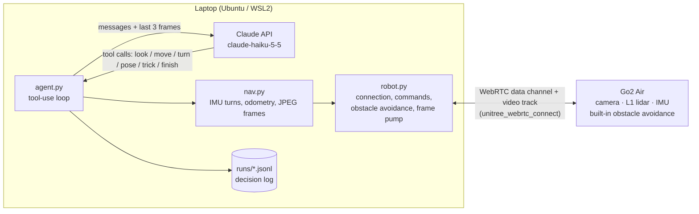

# robodog — an LLM-piloted Unitree Go2 Air

## What this is

An IF Lab research project. A Claude model pilots a **Unitree Go2 Air** around a room using the dog's own camera and lidar. Every decision it makes is logged together with its stated reasoning.

The longer-term goal is a **signed, publicly verifiable record of autonomous decisions**. That part is not built yet. Today the decision logs are plain, unsigned JSONL files (see [Logs](#logs)).

<!-- docs/architecture.png was requested here but no docs/ folder exists yet; the diagram below stands in for it. -->



The dog is the body. All code runs on the laptop. The laptop talks to the dog over WebRTC using [legion1581/unitree_webrtc_connect](https://github.com/legion1581/unitree_webrtc_connect), and to the Claude API over the internet.

---

## Hardware reality (this section saves people days)

- **This is the Go2 Air tier.** SSH is disabled, there's no docking board, and there's no usable onboard compute for our code. **Unitree SDK2, ROS 2 integration and low-level joint control are EDU-only features.** Don't go down those paths on an Air.
- **Everything runs on a laptop** talking to the dog over WebRTC via [unitree_webrtc_connect](https://github.com/legion1581/unitree_webrtc_connect). It's the same channel the Unitree phone app uses. Treat the dog as a body, not a computer.
- **The dog accepts exactly one WebRTC client at a time.** The Unitree mobile app must be **force-quit**, not just backgrounded, or connections stall (ICE stuck at `checking`, or `RobotBusyError`).
- **Reconnecting within about 20 seconds** of the previous session gets **HTTP 429** from the dog's signaling server (often surfacing as `NoSdpAnswerError`). Wait and retry.

---

## Network modes

Getting the network right was the hardest part of this project.

### AP mode — the laptop joins the dog's hotspot

- The dog broadcasts a `GO2-xxxx` Wi-Fi network. The laptop joins it, and the dog is always at `192.168.12.1`.
- It works anywhere, with no other network needed.
- **The laptop loses internet while joined, so there are no Claude API calls.** Fine for `drive.py`, `wander.py`, `four_moves.py` and the probe. Useless for the LLM scripts.
- The hotspot password rotates and is set in the Unitree app.
- Run with `./run.sh <cmd> --mode ap`, or set `UNITREE_MODE=ap` in `.env`.

### STA mode — the dog and the laptop both join a third network

- You need a network that **allows device-to-device traffic.** Campus and enterprise Wi-Fi usually has **client isolation** and blocks it. On campus Wi-Fi we never reached the dog.
- **A phone hotspot works and keeps internet**, so the LLM scripts can run. This is our working setup. Two catches:
  - The dog's DHCP address **changes between sessions.** Re-find it each time (see [Setup](#setup-from-scratch), step 7).
  - **Multicast discovery** (finding the dog by serial number) **didn't work on the phone hotspot**, so connect by IP.
- Set `UNITREE_MODE=sta` and `UNITREE_IP=<dog's address>` in `.env`, or pass `--mode sta --ip <addr>`.

### WSL2 users

- **Mirrored networking is required.** Add this to `%UserProfile%\.wslconfig` on Windows, then run `wsl --shutdown`:
  ```ini
  [wsl2]
  networkingMode=mirrored
  ```
- **The Wi-Fi network's profile must be *Private* in Windows** (Settings → Network & internet → Wi-Fi → the network → Network profile type). On *Public*, the Windows firewall blocks the inbound UDP that WebRTC's ICE needs. Signaling then succeeds but the connection hangs at `ICE checking` and fails with `DataChannelTimeoutError`. We hit exactly this, and switching to Private fixed it.

---

## Known traps

Each of these cost hours. Most are already handled in code; they're listed so nobody undoes the fix.

| Trap | Symptom | Fix (where) |
|---|---|---|
| **Brotli < 1.2.0 in the venv** | *Every* Anthropic API call fails with `APIConnectionError`. The real cause, hidden in `__cause__`, is `TypeError: process() takes no keyword arguments`: the HTTP client (`httpx2`) can't decompress the API's brotli responses. | `pip install -U "brotli>=1.2.0"` |
| **IPv6 to `api.anthropic.com` hangs on an iPhone hotspot** | API calls work but take 30–40 s each | `llm.py` forces IPv4 (`local_address="0.0.0.0"`). Calls take about 1 s. |
| **Only the first video callback ever gets frames** | `look()` returns "no frame" although the video channel is "on" | The driver hands the video track to registered callbacks one after another, and each loops forever. `robot.py` registers **one** frame pump right after connecting, and everything reads `robot.frame`. Don't call `add_track_callback` anywhere else. |
| **The dog's video service stops sending** | The track is offered and the channel switched on, but **zero** video packets arrive, even in `sensors_probe.py` | Power-cycle the dog. The LLM scripts refuse to run blind (`REQUIRE_CAMERA = True`). |
| **H264 decode warnings at startup** | Decoder errors and warnings scroll by on connect | Normal: the decoder is waiting for a keyframe. |
| **Joystick yaw sign** | Every turn on the avoidance path went the **opposite** way: +90 asked, −86 measured, consistently over 23 turns | On this dog, `rt/wirelesscontroller` `rx+` turns **right**. The driver example labels it "turn left". Confirmed from IMU heading vs. odometry travel direction. Fixed in `robot.py` (`rx = -z`), and `nav.turn_by` now aborts a turn that goes 20° the wrong way. *The fix has not been run on the dog yet.* |
| **With obstacle avoidance ON, speeds aren't m/s** | "0.3" is slow, and turns don't match rad/s | On the avoidance path, motion is sent as simulated joystick input (`rt/wirelesscontroller`), so values are **stick deflection (−1..1)**, scaled by the dog's speed level. Turns are closed-loop on IMU yaw instead of timed. |
| **Obstacle avoidance holds the dog** | A move that "succeeds" but covers about 0 m | Avoidance stopped him short of a chair: distance from home 0.80 → 0.81 → 0.82 → 0.83 m over four bursts. `agent.py`'s `pose()` reports distance moved since the last call, so the model can tell it's blocked. Whether avoidance also clamps motion in open space is untested; `avoid_test.py` measures it. |
| **API failures are fatal by design** | — | Every LLM script makes a tiny preflight call **before the dog stands**. Any API error prints a `!! API FAILURE - STOPPING THE DOG` banner, sends StopMove and exits with code 2. Nothing falls back to moving blind. |
| **Haiku 5.5 history-editing check** | Possible 400s once old images are pruned from the conversation | `agent.py` sends `thinking.block_binding.prefix_mismatch_behavior: "drop_block"` (beta `thinking-binding-controls-2026-08-01`), so the API drops invalidated older thinking blocks instead of failing. |
| **Unitree cloud login is bot-protected** | `get_key.py` gets an HTML challenge page (`EO_Bot_Ssid`) instead of JSON | Not worked around. Our dog connected without an AES key; see Setup, step 6. |

---

## Sensors available

Measured on our Go2 Air over WebRTC with `./run.sh probe` (10 s listen, read-only). **No bolt-on sensors are needed.** The camera, lidar point cloud and odometry all reach the laptop.

| Data | Topic | Rate seen | Notes |
|---|---|---|---|
| Lidar point cloud | `rt/utlidar/voxel_map_compressed` | 7.3 / s | Enable by publishing `"on"` to `rt/utlidar/switch`. Compressed voxel map, decoded by the driver (`libvoxel` or `native`). The lidar is front-mounted: **the dog can't see what's behind it.** |
| Lidar state | `rt/utlidar/lidar_state` | 5.0 / s | |
| Lidar odometry pose | `rt/utlidar/robot_pose` | 18.7 / s | `data.pose.position.{x,y,z}` + quaternion, `frame_id: "odom"`. `nav.py` uses this as position. |
| Sport state | `rt/lf/sportmodestate` | 20 / s | `position`, `velocity`, `imu_state.rpy` (yaw used for headings), `range_obstacle`, foot data |
| Multiple state | `rt/multiplestate` | 1.0 / s | Includes `obstaclesAvoidSwitch`, `speedLevel`, `volume`, … |
| Camera | WebRTC **video track** (not a data topic), via `conn.video.switchVideoChannel(True)` | ~11–12.5 fps | 1280×720. Downscaled to 640 px wide JPEGs before going to Claude. |

---

## Sport commands

All on topic **`rt/api/sport/request`** (`RTC_TOPIC["SPORT_MOD"]`). The firmware reports motion mode **`mcf`**.

| Command | api_id | Parameter | Notes |
|---|---|---|---|
| `Move` | **1008** | `{"x": vx, "y": vy, "z": vyaw}` | x forward, y left, z yaw. Sent **fire-and-forget** and re-sent at 10 Hz while moving. |
| `BalanceStand` | **1002** | — | Sent at the start of every script |
| `StopMove` | **1003** | — | Sent on every exit; also leaves Pose |
| `Pose` | **1028** | `{"data": true}` | Leave it with `StopMove` |
| `Dance1` | **1022** | — | |
| `MoonWalk` | **1305** | — | In the driver's older `SPORT_CMD` table only. **Rejected on `mcf` firmware.** |

**MCF no-reply variant (firmware 1.1.7+):** the driver's `sportmode_mcf.py` example sends `Move` without waiting for a reply. The request header carries `"policy": {"priority": 0, "noreply": true}`, and it goes out with `publish_without_callback`. `robot.py` sends every Move this way, since a 10 Hz loop can't wait for responses. Other commands are request/response, and their reply code is printed (0 = accepted).

Obstacle avoidance has its own topic, `rt/api/obstacles_avoid/request`: `SWITCH_SET` 1001 `{"enable": bool}`, `SWITCH_GET` 1002, its own `MOVE` 1003 `{"x","y","yaw","mode":0}`, and `USE_REMOTE_COMMAND_FROM_API` 1004. With avoidance on, `robot.py` drives through `rt/wirelesscontroller`, the path the driver's avoidance example demonstrates. The 1003 path is available via `AVOID_DRIVE_PATH = "api"` but has not been run on the dog.

---

## Setup from scratch

Assumes a fresh Ubuntu 24.04 machine (native or WSL2 with mirrored networking).

1. **System packages:**
   ```bash
   sudo apt update
   sudo apt install -y git python3-venv python3-pip portaudio19-dev
   ```
2. **This repo and a virtualenv:**
   ```bash
   git clone <this-repo-url> robodog && cd robodog
   python3 -m venv .venv
   source .venv/bin/activate
   ```
3. **The WebRTC driver.** Clone it inside the repo (it's gitignored) for its examples, then install it:
   ```bash
   git clone https://github.com/legion1581/unitree_webrtc_connect.git
   pip install ./unitree_webrtc_connect
   ```
4. **Python dependencies for the LLM scripts.** The Brotli pin matters; see [Known traps](#known-traps):
   ```bash
   pip install anthropic "brotli>=1.2.0" pillow
   ```
5. **Create `.env`** in the repo root (it's gitignored). Names only; fill in your own values:
   ```bash
   UNITREE_MODE=sta            # sta (shared network) or ap (dog's hotspot)
   UNITREE_IP=                 # dog's address on the shared network; sta mode only
   ANTHROPIC_API_KEY=          # for agent.py, explore.py, hallway.py, agent_live.py
   UNITREE_AES_128_KEY=        # only if the dog demands it (see step 6)

   # only for get_key.py (step 6); the script deletes UNITREE_PASSWORD after use
   UNITREE_EMAIL=
   UNITREE_PASSWORD=
   ```
   `chmod 600 .env`.
6. **Serial number and AES key.**
   - **The key:** our dog (motion mode `mcf`) connected in both AP and STA modes **with no AES key set**. The driver says firmware ≥ 1.1.15 requires a per-device key. If yours does, every connect fails with `AES_KEY_REQUIRED`. `python get_key.py` logs into Unitree's cloud with `UNITREE_EMAIL` and `UNITREE_PASSWORD` and writes `UNITREE_SERIAL` and `UNITREE_AES_128_KEY` to `.env`. **When we tried it, the cloud answered with a bot-check page instead of JSON, so this path is unproven.**
   - **The serial number** is printed on the dog and shown in the Unitree app. It's only needed for multicast discovery.
7. **Find the dog's IP (STA mode).** Fully close the Unitree app first.
   - Try multicast discovery first. It returns `{serial: ip}` and usually finds nothing on phone hotspots:
     ```bash
     python -c "from unitree_webrtc_connect import discover_ip_sn; print(discover_ip_sn(timeout=10))"
     ```
   - Otherwise, check the hotspot's or router's client list, or the Unitree app.
   - Or scan the subnet for the dog's signaling port, TCP **9991**:
     ```bash
     nmap -p 9991 --open <your-subnet>/24
     ```
   Put the address in `UNITREE_IP`. It changes between sessions on a phone hotspot.
8. **Verify before anything moves.** The probe is read-only. It connects, listens for 10 s, prints the [sensor table](#sensors-available) and disconnects:
   ```bash
   ./run.sh probe
   ```
   You want `YES` on every row, including the camera. If the camera row says `no`, power-cycle the dog.
9. **First motion.** Clear the floor, hold the remote, then try `./run.sh four` (about 10 s of small random moves) or `./run.sh` (keyboard driving).

`RUNBOOK.md` has the operator procedure and a table of every error message.

---

## Where to look

"On the dog" means it has actually been run on the real Go2. "Fake-tested" means it has only been run against a simulated dog (and, for the LLM scripts, sometimes the real Claude API).

| File | What it does | When you'd run it | Status |
|---|---|---|---|
| `robot.py` | Shared core: connection (`--mode`/`--ip`/`.env`), sport commands, obstacle-avoidance switch, velocity routing (sport Move vs. joystick), the single video frame pump, raw-terminal and ESC handling | Imported by everything | **Current.** Used in every on-dog run. |
| `nav.py` | IMU heading (degrees clockwise from start), closed-loop turns, timed driving, odometry pose, latest frame → 640 px JPEG | Imported by agent, explore, hallway, avoid_test | **Current.** The yaw-sign fix is not yet run on the dog. |
| `llm.py` | One Claude client: key from `.env`, IPv4 only, no retries, preflight check, fatal-error banner | Imported by the LLM scripts | **Current** |
| `agent.py` | **The main thing.** Goal on the command line; `claude-haiku-5-5` drives through the tools `look(turn_first?)`, `move`, `turn`, `pose`, `trick`, `finish`. Up to 150 steps, only the last 3 frames kept in history. | `./run.sh agent "your goal"` | **Current.** On the dog: one 43-step run, camera working, turns inverted (since fixed). |
| `drive.py` | Keyboard teleop: W/S/A/D/Q/E, SPACE stop, B avoidance toggle, +/− speed, R TrotRun, L speed level, U/I/O tricks | `./run.sh` | **Current.** On the dog (driving). |
| `sensors_probe.py` | Read-only check of lidar, odometry, state topics and camera | `./run.sh probe`, before any session | **Current.** On the dog. |
| `avoid_test.py` | Four 1.5 s forward trials (avoidance off/on × sport Move/joystick/avoid-API), measured with odometry | `./run.sh avoidtest`, to see whether avoidance clamps motion | **Current.** Fake-tested only. |
| `four_moves.py` | Smoke test: 4 random moves, 1.5 s each | `./run.sh four`, first motion of a session | **Current.** Fake-tested only. |
| `wander.py` | Dumb autonomy: walk forward and turn randomly on a timer or when stalled; refuses to run without avoidance | `./run.sh wander` | Proof of concept. Fake-tested only. |
| `explore.py` | Scan 4 headings, Claude picks the most open one, walk; ×3 | `./run.sh explore` | Earlier proof of concept, kept for reference. Fake-tested only. |
| `hallway.py` | Camera-guided walk to the end of a hallway, 180° turn, walk back to the start | `./run.sh hallway` | Earlier proof of concept, kept for reference. On the dog **while the API was broken**: it only ever walked forward on fallbacks, so its LLM decisions have never run on the dog. |
| `agent_live.py` | One JSON action per API call (no tools), optional `--vision` | `./run.sh live` | Earlier proof of concept, kept for reference. Fake-tested only. |
| `get_key.py` | Fetches serial and AES key from Unitree's cloud | Only if the dog demands a key | Blocked by the cloud's bot check when tried |
| `connect.py`, `connect_test.py`, `ap_test.py` | Early connect/disconnect tests (no motion) | Debugging connectivity | Superseded by `robot.py`. Kept for reference. |
| `envfile.py` | Tiny `.env` reader/writer | Imported | Current |
| `run.sh` | Activates the venv and runs a script: `drive` (default), `agent`, `probe`, `four`, `wander`, `explore`, `hallway`, `live`, `avoidtest`. Extra args pass through. Restores the terminal on exit. | Always | Current |
| `RUNBOOK.md` | Operator procedure, every key, every error message and its fix, how to recover a stuck terminal | Before and during a session | Current |
| `NOTES.md` | Field notes | — | — |

---

## Logs

Every run writes one JSON object per line to `runs/<YYYYMMDD-HHMMSS>-<script>.jsonl`. **`runs/` and `.env` are gitignored.** Camera images are **not** stored in the logs, only flagged.

### `*-agent.jsonl` (agent.py)

| Row | Fields |
|---|---|
| start | `t`, `event: "start"`, `goal`, `model`, `start_pos` ([x, y] metres, odometry frame) |
| one per model call | `t`; `step` (1…150); `stop_reason` (`tool_use`, `end_turn`, …); `text` (the model's visible reasoning for this step); `usage.in` / `usage.out` (tokens); `images_in_history` (≤ 3); `pruned_now` (frames turned into placeholders before this call); `thinking_dropped` (older thinking blocks the API dropped after pruning); `calls` (list of `{tool, input, result, image}`); `pose` / `pose_after` ([x, y] before and after the tools ran); `heading_deg` (clockwise from the start heading) |
| end | `t`, `event: "end"`, `why` (`finish: <reason>`, `step limit (150)`, `ESC / Ctrl+C`, or `API FAILURE: …`) |

### Other scripts

| Log | Fields |
|---|---|
| `*-explore.jsonl` | `t`, `iteration`, `model`, `frames` (`heading`, `t`, `actual_heading`, `had_image` per scan stop), `raw` (the model's reply verbatim), `stop_reason`, `fallback` (error text if the reply wasn't usable JSON, else null), `executed` (`heading`, `walk_s`, `turned_deg`, `turn_mode`) |
| `*-hallway.jsonl` | `t`, `leg` (OUT/RET), `burst`, `model`, `frame_t`, `raw`, `stop_reason`, `fallback`, `executed` (`action`, `walk_s`, `adjust_deg`, `drift_fix_deg`), `heading_deg`, `yaw_rad`, `pose`, `dist_home_m` |
| `*.jsonl` from `agent_live.py` | `t`, `vision`, `raw` |
| `*-avoidtest.jsonl` | `t`, `trial`, `desc`, `seconds`, `value`, `dist_m`, `speed_mps`, `yaw_change_deg`, `avoid_on`, `p0`, `p1` |

---

## Safety

- **An operator supervises every run**, standing near the dog with the **physical Unitree remote in hand. The remote is the real emergency stop.** ESC or Ctrl+C on the laptop sends StopMove and is the normal way to stop a script, but it depends on the laptop, the network and the WebRTC link all working.
- **Clear the floor** before any motion, especially for autonomous scripts. People nearby should know the dog may move without warning.
- **Rear blind spot:** the camera and lidar face forward, so the dog can't detect what is behind it. Backward motion isn't offered to the LLM, and the autonomous scripts only walk forward and turn in place. Backward is available only in `drive.py` (the S key), where you're watching.
- **Conservative speeds:** default 0.3 (m/s on the sport path; stick deflection with avoidance on), with moves capped at 3 s per tool call and a hard cap of 1.0 m/s in `robot.py`. Running gaits (`drive.py` R and L) are for open space only.
- **Obstacle avoidance on:** every autonomous and LLM script switches obstacle avoidance on at startup and **refuses to start** if the dog doesn't confirm it.
- **Failure means stop:** API failures, a missing camera (LLM scripts) and lost robot replies all stop the dog. Nothing falls back to motion it can't justify.
